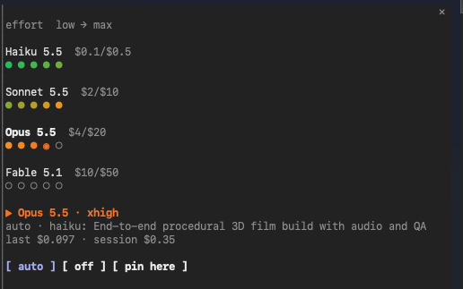
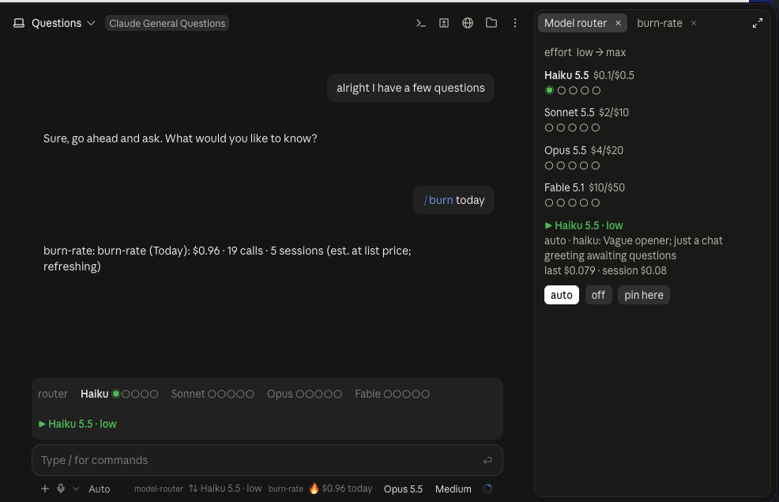
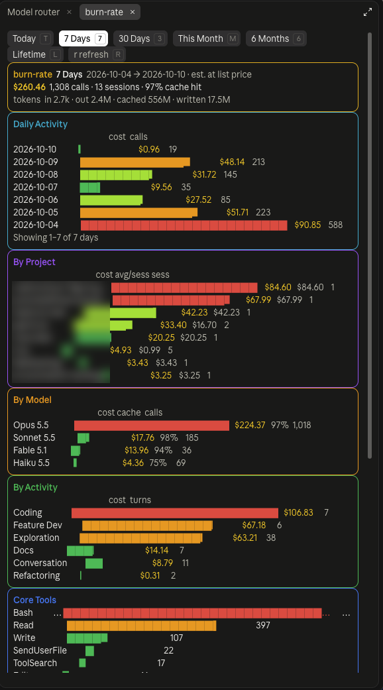
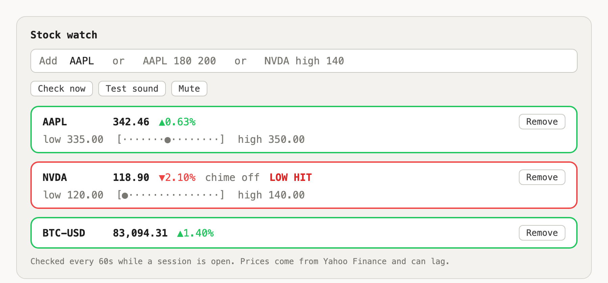
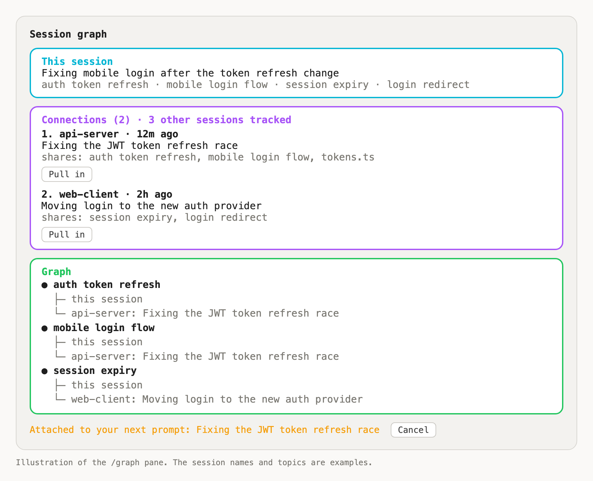

<p align="center">
  
</p>

<p align="center">
  <b>Small mods for <a href="https://claude.com/claude-code">Claude Code</a>: live panes, guards and smarter defaults.</b>
</p>

> The mod API is early access and may change between Claude Code releases. Mods draw in the Claude Code terminal and in **local** sessions in the Claude Desktop app's Code tab. They do not draw in cloud sessions, or in a desktop window that is only mirroring a session a terminal started. Install from a terminal; local desktop sessions on the same machine pick them up.

## Install

```
/plugin marketplace add troyjlorents-gh/mod-squad
/plugin install <mod>@mod-squad
```

## The squad

| Mod | What it does |
| --- | --- |
| [`model-router`](mods/model-router) | Picks the cheapest model + effort for every turn (Haiku 5.5 → Sonnet 5.5 → Opus 5.5 → Fable 5.1) and draws a live green → red cost ladder in a side pane. |
| [`burn-rate`](mods/burn-rate) | `/burn` opens a cost dashboard inside Claude Code: spend by day, project, model, activity, tool and shell command, read from your local session logs. No account, nothing sent anywhere. Inspired by [codeburn](https://github.com/getagentseal/codeburn). |
| [`context-gauge`](mods/context-gauge) | A band above the prompt: how full the context window is, shading green → red, with a toast before it fills up. |
| [`safety-net`](mods/safety-net) | Blocks force-pushes, `git reset --hard`, `rm -rf ~`, `terraform destroy`, `curl \| sh` and writes to `.env` / keys, and tells the model why. |
| [`secret-scrubber`](mods/secret-scrubber) | Redacts AWS, GitHub, Anthropic, OpenAI, Azure, Slack, Stripe and Google keys, JWTs and private keys from tool output before anything stores or reads it. |
| [`turn-recap`](mods/turn-recap) | A one-line TL;DR under long answers, written by Haiku 5.5 for a fraction of a cent. |
| [`standup`](mods/standup) | `/standup` → **Generate**: reads the day's sessions and writes a standup of what you got done, grouped by project, saved as markdown. |
| [`session-graph`](mods/session-graph) | A knowledge graph across your sessions: alerts you when two of them are covering the same ground, and `/graph` pulls one's findings into the other. |
| [`stock-watch`](mods/stock-watch) | `/stock add AAPL low 180 high 200`: watches a ticker, or just its price, and plays a rising or falling chime, plus a toast, when it reaches your high or low. |
| [`ping`](mods/ping) | A chime + toast when a long turn finishes or is waiting for your approval, so you can walk away. |

Install one, or all ten: `/plugin install model-router@mod-squad`, `/plugin install safety-net@mod-squad`, ...

### model-router



Every lit dot is a rung at or below what is running now; the shaded `◉` is the current model + effort. Below the ladder: why it was picked, what the last turn cost, and the running session total.

It also shows as a band above the prompt box in the Claude Desktop app, in a local Code session:



### burn-rate



### stock-watch



The pictures here are illustrations; the prices are examples. Under the prompt it shows one line, `AAPL 342.46 ▲ · NVDA 227.35 ▼ · BTC-USD 83,094 ▲ +2`, with ▲ or ▼ measured from today's open.

```
/stock add AAPL                        just watch the price, no alerts
/stock add AAPL low 335 high 350       alert at 335 or below, and at 350 or above
/stock NVDA 120 140                    shorthand: low then high
/stock add BTC-USD high 90000          one limit is fine
/stock chime off | on                  the chime for every ticker (toasts still show)
/stock AAPL chime off | on             the chime for one ticker
/stock rm AAPL                         stop watching it
/stock list | check | test             print the list, fetch now, play both chimes
```

A rising chime plays at your high, a falling chime at your low, and each limit alerts once. Full details, settings and examples: [mods/stock-watch](mods/stock-watch).

### session-graph



The pictures here are illustrations; the sessions and topics are examples. Each session writes a small note about what it is working on (a summary, topics, the files it edited) into a shared folder, `~/.claude/session-graph`, and reads the other sessions' notes from it. That folder is how your sessions find each other. When two of them cover the same ground, you get a toast:

```
session-graph: "Fixing the JWT token refresh race" in api-server also covers auth token refresh, mobile login flow. /graph to see it
```

```
/graph                  open the pane: this session, its connections, the topic graph
/graph pull 1           attach connection 1's findings to your next prompt, once
                        (type the number of the connection, e.g. 1 or 2)
/graph off | on         stop recording this session and make others skip it, or turn it back on
```

It links sessions on one machine only, and you can set how readily sessions link (`strict`, `normal`, `loose`). Full details, settings and what the shared folder holds: [mods/session-graph](mods/session-graph).

## Build your own mod

A mod is a folder in `mods/<name>/`:

```
mods/<name>/
  .claude-plugin/plugin.json
  hooks/hooks.json
  hooks/register.tsx
  tests/*.test.ts
```

List it in `.claude-plugin/marketplace.json`, then:

```
claude plugin validate mods/<name>
claude plugin test mods/<name>
```
