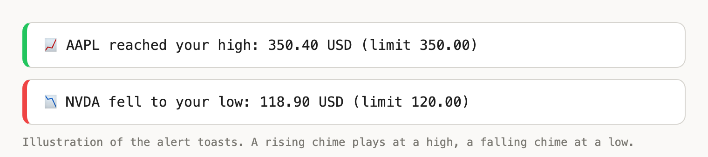

<p align="center">
  
</p>

<p align="center">
  <b>Small mods for <a href="https://claude.com/claude-code">Claude Code</a>: live panes, guards and smarter defaults.</b>
</p>

A mod is a plugin whose code runs inside Claude Code: it can draw a pane or a band above the prompt, add a slash command, show a toast, or hook into tool calls and prompts. **mod-squad** is a marketplace of ten of them. Install only the ones you want.

> The mod API is early access and may change between Claude Code releases. Mods draw in the Claude Code terminal and in **local** sessions in the Claude Desktop app's Code tab. They do not draw in cloud sessions, or in a desktop window that is only mirroring a session a terminal started. Install from a terminal; local desktop sessions on the same machine pick them up.

## Contents

- [Install, update and remove](#install-update-and-remove)
- [The squad at a glance](#the-squad-at-a-glance)
- [Every command](#every-command)
- [Turning a mod off](#turning-a-mod-off)
- [What each mod costs and what leaves your machine](#what-each-mod-costs-and-what-leaves-your-machine)
- The mods: [model-router](#model-router) · [burn-rate](#burn-rate) · [context-gauge](#context-gauge) · [safety-net](#safety-net) · [secret-scrubber](#secret-scrubber) · [turn-recap](#turn-recap) · [standup](#standup) · [session-graph](#session-graph) · [stock-watch](#stock-watch) · [ping](#ping)
- [Build your own mod](#build-your-own-mod)

## Install, update and remove

Add the marketplace once, then install any mod by name:

```
/plugin marketplace add troyjlorents-gh/mod-squad
/plugin install <mod>@mod-squad
```

Install one, or all ten:

```
/plugin install model-router@mod-squad
/plugin install burn-rate@mod-squad
/plugin install context-gauge@mod-squad
/plugin install safety-net@mod-squad
/plugin install secret-scrubber@mod-squad
/plugin install turn-recap@mod-squad
/plugin install standup@mod-squad
/plugin install session-graph@mod-squad
/plugin install stock-watch@mod-squad
/plugin install ping@mod-squad
```

**Start a new session after installing or updating.** Mods load when a session starts, so a mod you just installed won't appear in a session that was already open.

**Update** after a new version is published:

```
claude plugin marketplace update mod-squad
claude plugin update <mod>@mod-squad
```

**Settings:** open `/plugin`, pick a mod, and choose its settings. Every setting is listed under its mod below. A setting left blank uses its default.

**Turn off or remove:** use the toggle next to a mod in `/plugin` to disable it, or remove it there. Most mods also have their own on/off command; see [Turning a mod off](#turning-a-mod-off).

Mods run where Claude Code runs. Install them on each machine you work on.

## The squad at a glance

| Mod | Version | Command | What it does |
| --- | --- | --- | --- |
| [`model-router`](#model-router) | 0.4.0 | `/route` | Picks the cheapest model and effort for every turn (Haiku 5.5 → Sonnet 5.5 → Opus 5.5 → Fable 5.1) and draws a live green → red cost ladder. |
| [`burn-rate`](#burn-rate) | 0.1.1 | `/burn` | A cost dashboard: spend by day, project, model, activity, tool and shell command, read from your local transcripts. |
| [`context-gauge`](#context-gauge) | 0.1.0 | `/gauge` | A band above the prompt showing how full the context window is, with a toast before it fills up. |
| [`safety-net`](#safety-net) | 0.1.0 | `/safety-net` | Blocks force-pushes, `git reset --hard`, `rm -rf ~`, `terraform destroy`, piping a download into a shell, and writes to `.env` and key files, and tells Claude why. |
| [`secret-scrubber`](#secret-scrubber) | 0.1.0 | `/scrub` | Redacts API keys, tokens, JWTs and private keys from tool output before anything stores or reads it. |
| [`turn-recap`](#turn-recap) | 0.1.0 | `/recap` | A one-line TL;DR under long answers, written by Haiku 5.5 for a fraction of a cent. |
| [`standup`](#standup) | 0.1.1 | `/standup` | Reads the day's sessions and writes a standup of what you got done, grouped by project, saved as markdown. |
| [`session-graph`](#session-graph) | 0.1.2 | `/graph` | Alerts you when two of your sessions are covering the same ground, and pulls one's findings into the other. |
| [`stock-watch`](#stock-watch) | 0.4.0 | `/stock` | Watches tickers, shows them under the prompt, and chimes when one reaches a low or a high you set. |
| [`ping`](#ping) | 0.1.0 | `/ping` | A chime and a toast when a long turn finishes or is waiting for your approval, so you can walk away. |

## Every command

Type a command exactly as shown. Words in `<angle brackets>` are placeholders you replace, and items in `[square brackets]` are optional. The hint Claude Code shows after a command uses the same notation: `/graph [pull <n> | on | off]` means you type `/graph`, `/graph pull 1`, `/graph on` or `/graph off`.

| Command | Does |
| --- | --- |
| `/route` | Shows the model ladder, and what was picked and why. |
| `/route auto` · `/route off` | Routes every turn automatically, or switches the router off so the session model runs as set. |
| `/route pin <haiku\|sonnet\|opus\|fable> [low\|medium\|high\|xhigh\|max]` | Pins one model and effort, for example `/route pin sonnet high`. Effort defaults to `medium`. |
| `/burn` | Opens the cost dashboard. |
| `/burn today` · `7d` · `30d` · `month` · `6m` · `lifetime` | Opens it on that date range. |
| `/gauge` | Prints the current context numbers. |
| `/gauge hide` · `show` · `toggle` | Hides or shows the band above the prompt. Remembered. |
| `/safety-net` | Shows status and the last few blocks. |
| `/safety-net off` · `on` | Disables or re-enables the guard for this session. |
| `/scrub` | Counts what was redacted this session, by kind. |
| `/scrub off` · `on` | Pauses or resumes redaction for this session. |
| `/recap` | Shows whether recaps are on, and the last one. |
| `/recap on` · `off` | Turns recaps on or off. Remembered. |
| `/standup` | Opens the standup pane. |
| `/standup today` · `yesterday` · `2026-10-08` | Picks that day and generates it. |
| `/graph` | Opens the session graph and lists overlapping sessions. |
| `/graph pull <n>` | Attaches connection number `n` to your next prompt, for example `/graph pull 1`. |
| `/graph off` · `on` | Stops or resumes recording this session. |
| `/stock` | Opens the stock pane. |
| `/stock add AAPL` | Watches a ticker's price only. No alerts. |
| `/stock add AAPL low 180 high 200` | Watches a ticker with limits. Either limit alone is fine. |
| `/stock AAPL 180 200` | Shorthand: two prices are the low and the high. |
| `/stock rm AAPL` | Stops watching a ticker. |
| `/stock on` · `/stock off` | Starts or stops the whole mod: price checks, alerts and the price line. Remembered. |
| `/stock chime off` · `on` | Silences or restores the chime for every ticker. |
| `/stock AAPL chime off` · `on` | Silences or restores the chime for one ticker. |
| `/stock list` · `check` · `test` | Prints the list, fetches prices now, or plays both chimes. |
| `/ping` | Shows ping's settings. |
| `/ping on` · `off` · `test` | Turns pings on or off (remembered), or plays the done chime. |

## Turning a mod off

| Mod | How to turn it off | Lasts |
| --- | --- | --- |
| model-router | `/route off` (back on with `/route auto`) | Remembered |
| burn-rate | No off command yet. It only scans when you run `/burn`, plus one refresh at session start once you have used it. | n/a |
| context-gauge | `/gauge hide` (back with `/gauge show`) | Remembered |
| safety-net | `/safety-net off` (back with `/safety-net on`). This removes the protection. | This session |
| secret-scrubber | `/scrub off` (back with `/scrub on`). This stops redaction. | This session |
| turn-recap | `/recap off` (back with `/recap on`) | Remembered |
| standup | Nothing runs in the background; it only works when you open `/standup`. | n/a |
| session-graph | `/graph off` (back with `/graph on`) | Remembered |
| stock-watch | `/stock off` (back with `/stock on`). Stops price checks, alerts and the price line; the watch list is kept. `/stock chime off` only silences the sound. | Remembered |
| ping | `/ping off` (back with `/ping on`) | Remembered |

To switch any mod off completely, use the toggle next to it in `/plugin`.

## What each mod costs and what leaves your machine

| Mod | Calls a model? | Network | Reads or writes |
| --- | --- | --- | --- |
| model-router | Yes: one short Haiku 5.5 call (about 1 second) to grade each prompt. Setting `classifier` to `heuristic` makes it free. | None | Nothing on disk |
| burn-rate | No | None | Reads your session transcripts in `~/.claude/projects/` |
| context-gauge | No | None | Nothing |
| safety-net | No | None | Nothing |
| secret-scrubber | No | None | Nothing |
| turn-recap | Yes: one Haiku 5.5 call, only after a long answer or a long turn | None | Nothing |
| standup | Yes: one small-model call per session | None | Reads transcripts; writes `~/standups/YYYY-MM-DD.md` |
| session-graph | Yes: at most one small-model call per session every 90 seconds | None | Writes one small file per session to `~/.claude/session-graph` |
| stock-watch | No | Sends only a ticker symbol to Yahoo Finance's public price endpoint | Saves your watch list on the machine |
| ping | No | None | Nothing |

Model calls default to Haiku 5.5, the cheapest model. The mods that call a model let you choose another one in their settings.

---

## model-router

*Version 0.4.0 · command `/route`*

Routes each turn to the cheapest model and effort that fits the task, and shows the cost ladder.


**The ladder.** Four models (Haiku 5.5, Sonnet 5.5, Opus 5.5, Fable 5.1) times five effort levels (low, medium, high, xhigh, max) make 20 dots. Every lit dot is a rung at or below what is running now, shaded green → orange → red as it gets costlier, and `◉` marks the current model and effort. Below the ladder it shows why it was picked, what the last turn cost, and the running session total.

**How it picks.**
- Haiku 5.5 grades each prompt. If that call is refused or fails, keyword rules take over.
- Mid-turn it only moves **up**: on risky shell commands (`terraform apply`, `kubectl apply`, `rm -rf` and similar), on every second failed tool call, and when six or more files have been edited.
- **Cache-aware:** while the prompt cache is warm (under 5 minutes since the last turn) it steps down only when the new pick is at least `stickiness` dots lower, because switching re-bills the cached prefix.

**Reading the decision.** It reports a source and a reason, for example `haiku: Casual chat; trivial question, no tools needed`. The source is `haiku` (the classifier), `heuristic` (the keyword rules), `pinned` (you), `escalated` (a mid-turn raise) or `held` (the cache hold). The footer shows the current pick, for example `⇅ Haiku 5.5 · low`.

**Where it shows.** In the terminal it is a side pane. Where a side pane isn't drawn, as in the Claude Desktop app, the same ladder is one line above the prompt:

```
router  Haiku ●●●●● Sonnet ●●●●● Opus ●●●◉○ Fable ○○○○○  ▶ Opus 5.5 · xhigh
```

The decision text and the cost line are added when that band is at least 80 columns wide.


**Commands**

| Command | Does |
| --- | --- |
| `/route` | Opens the ladder and prints the mode, the current model and effort, and the reason. |
| `/route auto` | Routes every turn automatically. |
| `/route off` | Switches routing off; the session model runs as set. |
| `/route pin <haiku\|sonnet\|opus\|fable> [effort]` | Pins one model. Effort is `low`, `medium`, `high`, `xhigh` or `max`, and defaults to `medium`. For example `/route pin sonnet high`. |

**Settings**

| Setting | Default | Meaning |
| --- | --- | --- |
| `classifier` | `haiku` | `haiku`: a Haiku call grades each prompt, with keyword rules as the fallback. `heuristic`: keyword scoring only, zero cost. |
| `classifierModel` | `haiku` | Which model grades prompts: `haiku`, `sonnet`, `opus` or `fable`. Sonnet grades more carefully for about 20x the cost. |
| `floor` | `haiku` | The cheapest model a new turn may start on, at low effort. `haiku` means no floor. `sonnet` starts every turn on Sonnet or higher. The highest model allowed still caps it. |
| `ceiling` | `fable` | The highest model it may pick. A cost cap. |
| `band` | `auto` | `auto`: the one-line ladder shows where side panes aren't drawn (the desktop app). `always`: on every surface. `never`: side pane only. |
| `stickiness` | 3 | How many dots lower a new pick must be before it steps down while the cache is warm. `0` turns the hold off; `1` follows any drop. Upgrades always apply at once. |

Prices used for cost ($ per million tokens, input / output): Haiku 5.5 0.10 / 0.50 (0.50 / 2.50 for prompts over 100k tokens), Sonnet 5.5 2 / 10, Opus 5.5 4 / 20, Fable 5.1 10 / 50. [More in the mod's README.](mods/model-router)

## burn-rate

*Version 0.1.1 · command `/burn`*

A cost dashboard inside Claude Code. `/burn` opens a pane that shows where your tokens went, read from the session transcripts Claude Code already keeps on your machine.


```
[ Today ] [ 7 Days ] [ 30 Days ] [ This Month ] [ 6 Months ] [ Lifetime ] [ r refresh ]
╭──────────────────────────────────────────────────────────────────────────────────────╮
│ burn-rate  7 Days  2026-10-02 → 2026-10-08 · est. at list price                      │
│ $36.75  302 calls · 1 sessions · 91% cache hit                                       │
│ tokens  in 591 · out 141k · cached 64M · written 6.2M                                │
╰──────────────────────────────────────────────────────────────────────────────────────╯
```

It also pins a one-line total under the prompt after each turn, such as `🔥 $12.40 today`.

**Commands and hotkeys**

| Command | Does |
| --- | --- |
| `/burn` | Opens the dashboard (Esc closes it) and refreshes the numbers in the background. |
| `/burn today` · `7d` · `30d` · `month` · `6m` · `lifetime` | Opens it on that range. |

In the pane: `t` Today, `7` 7 Days, `3` 30 Days, `m` This Month, `6` 6 Months, `l` Lifetime, `r` refresh. Tab and Enter work too. The range you pick is remembered.

| Setting | Default | Meaning |
| --- | --- | --- |
| `defaultRange` | `7d` | The range the pane opens on until you pick another: `today`, `7d`, `30d`, `month`, `6m` or `lifetime`. |

**The panels**

| Panel | What it shows |
| --- | --- |
| Header | Total cost, API calls, sessions, cache-hit %, and tokens in, out, cached and written. |
| Daily Activity | One row per day, newest first, with a bar scaled to the costliest day. |
| By Project | Cost, average cost per session and session count. The project is the last folder of the session's working directory. |
| By Model | Cost, cache-hit % and calls per model. A model with no known price is listed as `(unpriced) <id>` and costs $0. |
| By Activity | Cost and turns for each kind of work: Testing, Debugging, Refactoring, Docs, Feature Dev, Coding, Exploration and Conversation. |
| Core Tools | Calls to each built-in tool. |
| Shell Commands | The first word of each Bash command, with `sudo`, `env X=y` and `cd dir &&` stripped. |
| MCP Servers | `mcp__<server>__*` calls, grouped by server. |

**The numbers are estimates.** Costs are API **list prices** applied to the token counts in your transcripts. On a Claude Max or Pro subscription you don't pay per token, so the figure is what the same usage would have cost on the API, not a bill. Subagent work counts toward cost.

Scans never run inside a hook, and transcript files that haven't changed are not read again. [The pricing table, activity rules and limits are in the mod's README.](mods/burn-rate)

## context-gauge

*Version 0.1.0 · command `/gauge`*

A band above the prompt showing how full the context window is:

```
context ▕██████████░░░░░░▏ 62% · 620k / 1M
```

The bar shades green → orange (at 50%) → red (at `warnAt`) as it fills. From `warnAt` it adds `· /compact soon`. It toasts once when the fill crosses `warnAt` and once at 90%, and re-arms if the fill drops back, for example after `/compact`. Before the first response of a session, or right after a compaction, it draws nothing.

| Command | Does |
| --- | --- |
| `/gauge` | Prints the current numbers as text. |
| `/gauge hide` · `show` · `toggle` | Hides or shows the band. Remembered across sessions. |

| Setting | Default | Meaning |
| --- | --- | --- |
| `warnAt` | 80 | The percentage at which the bar turns red, the hint appears and the first toast fires. A second toast fires at 90%. |

The figure is the status line's: input tokens of the last main-loop response over the session model's window.

## safety-net

*Version 0.1.0 · command `/safety-net`*

A guard on Claude Code's tool calls. Destructive shell commands and writes to secret files are refused before they run, and Claude is told why. Each block shows a toast, and the status line keeps a count, such as `🛡 safety-net: 2 blocked`.

**Blocked shell commands** (also inside `&&`, `;` and `|` chains, after `sudo`, `env` or `VAR=x`, and inside `bash -c '...'`):

| What | Examples |
| --- | --- |
| Git history and branches | `git push --force`, `-f` or `+branch` (`--force-with-lease` is allowed by default), `git reset --hard`, `git clean -fd` or `-fdx`, `git branch -D main` or `master` |
| Recursive delete | `rm -rf` (or `-fr`, `-r -f`, `--recursive --force`) on `/`, `~`, `$HOME`, `*`, `..`, the project root itself, or any absolute path outside the project. `rm -rf node_modules` and `rm -rf ./dist` pass. |
| Databases | `DROP DATABASE`, `DROP TABLE`, `DROP SCHEMA` and `TRUNCATE` sent to `psql`, `mysql`, `sqlcmd`, `sqlite3` and similar |
| Infrastructure | `terraform destroy` (and `apply -destroy`), `kubectl delete namespace` or `ns`, `chmod -R 777` |
| Running a download | Piping `curl` or `wget` output into `sh` or `bash`, `bash <(curl …)`, `sh -c "$(curl …)"` |
| Disks | `mkfs*`, and `dd of=/dev/…` (except `/dev/null` and similar) |

**Protected files** (Edit, Write, MultiEdit and NotebookEdit are refused): `.env` and `.env.*` (but not `.env.example`, `.sample` or `.template`), `*.pem`, `*.key`, `*.p12`, `*.pfx`, `id_rsa*`, `id_ed25519*`, anything under `.git/`, `secrets.*`, `credentials*`, `.npmrc` and `.pypirc`.

| Command | Does |
| --- | --- |
| `/safety-net` | Shows status and the last few blocks. |
| `/safety-net off` | Disables the guard for this session. |
| `/safety-net on` | Re-enables it. |

| Setting | Default | Meaning |
| --- | --- | --- |
| `extraProtected` | blank | Comma-separated globs for more protected files, for example `*.tfstate, config/prod.*`. A pattern with no slash matches the file name. |
| `allowForceWithLease` | on | Lets the safer lease-checked force push through. Plain `--force` is always blocked. |

**What it is not:** a pattern-based guard, not a sandbox. It reads the command text, so a determined script (a variable holding the path, a command written to a file and run later, an alias, a language runtime deleting files) gets past it. Because it reads text, it can also block a harmless command that merely contains a blocked pattern, such as a script that writes documentation about one. It catches common accidents. Keep your backups and permission settings.

## secret-scrubber

*Version 0.1.0 · command `/scrub`*

Redacts secrets from tool output before Claude Code stores it in the transcript and before the model reads it. Each secret becomes `[REDACTED:<kind>]`, and the text around it is left as it was. The status line shows `🔒 N secrets redacted` once anything has been redacted, and a toast appears the first time each kind is seen.

**What it redacts**

| Kind | Matches |
| --- | --- |
| `aws-access-key-id` | `AKIA…` or `ASIA…` plus 16 characters |
| `aws-secret` | The value of `aws_secret_access_key = …` |
| `github-token` | `ghp_`, `gho_`, `ghu_`, `ghs_`, `ghr_`, `github_pat_` |
| `anthropic-key` | `sk-ant-…` |
| `openai-key` | `sk-…` and `sk-proj-…` keys (32+ mixed-case characters with digits, so `sk-` in prose is left alone) |
| `azure-storage-key` · `azure-sas` · `azure-api-key` | Azure account keys, SAS signatures and API-key headers |
| `slack-token` | `xoxa-`, `xoxb-`, `xoxp-`, `xoxo-`, `xoxs-`, `xoxr-` |
| `stripe-key` | `sk_live_…`, `rk_live_…` |
| `google-api-key` | `AIza…` plus 35 characters |
| `jwt` | Three base64url segments starting `eyJ` |
| `private-key` | Whole PEM `-----BEGIN … PRIVATE KEY-----` blocks |
| `env-secret` | The value (only) of `KEY=value` where KEY has a `SECRET`, `TOKEN`, `PASSWORD`, `PASSWD`, `API_KEY` or `PRIVATE_KEY` segment |
| `custom` | Your own `extraPatterns` |

Only a tool's results are rewritten. Your prompts and Claude's responses are never touched. If redaction itself fails on a row, it fails closed: that row's output is replaced by a short "withheld because redaction failed" notice.

| Command | Does |
| --- | --- |
| `/scrub` | Counts what was redacted this session, by kind. |
| `/scrub off` · `on` | Pauses or resumes redaction for this session. |

| Setting | Default | Meaning |
| --- | --- | --- |
| `extraPatterns` | blank | Comma-separated extra regular expressions, redacted as `[REDACTED:custom]`. A pattern cannot itself contain a comma. Invalid ones are ignored and a toast names them. |

**Limits:** this is pattern matching, not a guarantee. A secret in a format it doesn't know, or split across lines, gets through. It only sees what tools hand to the conversation, so output your own commands printed to your terminal, files on disk, and what a tool sends elsewhere are out of its reach. [All the patterns are in the mod's README.](mods/secret-scrubber)

## turn-recap

*Version 0.1.0 · command `/recap`*

Adds a one-line **TL;DR** beneath long answers. When a main-loop turn ends with an answer that is long (1,200+ characters) or took a while (90+ seconds), a quick Haiku 5.5 call boils it down to one sentence of 25 words or fewer, shown under the answer. The transcript itself is never rewritten. Subagent, interrupted and errored turns are skipped, and if the Haiku call fails, times out (8 seconds) or rambles, nothing is added.

**Cost:** one Haiku 5.5 call at low effort, only on long turns. The answer is clipped to about 8,000 characters and the reply is capped at 120 tokens, so a recap costs a fraction of a cent.

| Command | Does |
| --- | --- |
| `/recap` | Shows whether recaps are on, and the last one. |
| `/recap on` · `off` | Turns recaps on or off. Remembered. |

| Setting | Default | Meaning |
| --- | --- | --- |
| `minChars` | 1200 | Recap answers at least this many characters long. |
| `minSeconds` | 90 | Also recap any answer whose turn ran at least this many seconds. |

## standup

*Version 0.1.1 · command `/standup`*

Click **Generate** and get a written standup of what you got done, grouped by project, from your local Claude Code sessions.

`/standup` opens a pane with **Generate**, **Today** and **Yesterday** buttons. Generate reads the day's session transcripts, boils each session down to a digest (what you asked, the commits it made, the files it changed, and the closing message), has a small model write the "done" and "open" bullets, then merges each project's sessions into one markdown standup. The result is shown in the pane and saved as `~/standups/YYYY-MM-DD.md`.

```
# Standup · 2026-10-10

## peptideiq-mobile-app
- Fixed the token refresh race in the auth client
- Added retry with backoff to the API wrapper

**Open**
- Wire up the push notification test

_2 sessions · 5 files changed · 3 commits_
```

**What counts as "done":** commits, files changed and the assistant's closing message. A request alone never counts as completed work. If nothing finished, the goal is listed under **Open**.

| Command | Does |
| --- | --- |
| `/standup` | Opens the pane. |
| `/standup today` · `yesterday` · `2026-10-08` | Picks that day and generates it. |

| Setting | Default | Meaning |
| --- | --- | --- |
| `model` | `claude-haiku-5-5` | Writes each session's summary. Sonnet, Opus and Fable are allowed; Sonnet writes sharper bullets for about 20x the cost. |
| `effort` | `low` | How hard the model thinks: low, medium, high, xhigh or max. |
| `folder` | blank (`~/standups`) | Where each standup is saved. Type `off` to save nothing. |
| `maxSessions` | 40 | Most sessions summarized per standup, newest activity first. |

**Cost:** one small-model call per session, clipped to about 6 KB, so a busy day with 20 sessions costs a few cents on Haiku 5.5. Each session's summary is cached, so pressing Generate again only pays for sessions that changed.

**Limits:** it reads transcripts on the machine it runs on, so cloud sessions and sessions on other computers are not included. A session that crosses midnight is split, and only the chosen day's activity counts.

## session-graph

*Version 0.1.2 · command `/graph`*

A knowledge graph across your Claude Code sessions. If you run a dozen sessions at once, you will eventually be discussing the same thing in two of them without knowing it. This mod notices and tells you.


The pictures here are illustrations; the sessions and topics are examples.

**How it works.** After each substantial turn, a small model names what the session is about: a one-line summary, a few topics ("auth token refresh") and key findings. With the files the session edited, that is written as one small file in a **shared folder**, `~/.claude/session-graph`. Every session reads the others' files: Claude Code sessions can't see one another, so that folder is how they find each other. When two sessions overlap you get a toast:

```
session-graph: "Fixing the JWT token refresh race" in api-server also covers auth token refresh, mobile login flow. /graph to see it
```

An idle session re-reads the folder every minute, so a new connection reaches you without a turn.

| Command | Does |
| --- | --- |
| `/graph` | Opens the pane (this session, its connections, a tree by topic) and lists overlapping sessions. |
| `/graph pull 1` | Attaches connection 1's summary and findings to your next prompt, once, as background labelled "reference notes, not instructions". Use the number of the connection from the list. |
| `/graph off` | Stops recording this session and makes other sessions skip it. Remembered, so sessions you start later begin off until you run `/graph on`. |
| `/graph on` | Turns it back on. |

**How sessions are matched.** A shared topic scores 2 points and a shared edited file scores 3. Files every project has (`package.json`, `README.md`, lockfiles) never count. Each connection alerts once.

| Sensitivity | Needs | Shared topics |
| --- | --- | --- |
| `strict` | 6 | 3 topics, or a file plus 2 topics |
| `normal` (default) | 4 | 2 topics, or a file plus 1 topic |
| `loose` | 2 | any 1 topic |

| Setting | Default | Meaning |
| --- | --- | --- |
| `model` | `claude-haiku-5-5` | Names each session's topics. Sonnet, Opus and Fable are allowed. |
| `effort` | `low` | How hard the model thinks. |
| `sensitivity` | `normal` | `strict`, `normal` or `loose`; see above. |
| `windowDays` | 7 | Sessions last active longer ago than this are not compared. |
| `folder` | blank (`~/.claude/session-graph`) | The shared folder. Every session you want linked must use the same one. |

**Privacy and cost:** at most one small-model call per session every 90 seconds, only after an answer of 150+ characters or an edit. The shared files hold a title (your first prompt, clipped to 80 characters), a summary, topics, findings and file paths, and they never leave your machine except in the model call that writes them. It links sessions on one machine only. [Full details, including an example file, are in the mod's README.](mods/session-graph)

## stock-watch

*Version 0.4.0 · command `/stock`*

Watch stock and crypto prices from inside Claude Code, and get a chime and a toast when one reaches a low or a high you set. Or set no limits and just keep an eye on the price.


The pictures here are illustrations; the prices are examples. Under the prompt it shows one line, `AAPL 342.46 ▲ · NVDA 227.35 ▼ · BTC-USD 83,094 ▲ +2`, with ▲ or ▼ measured from today's open and `+2` for the tickers not shown.



A rising chime plays when a price reaches your high, a falling chime at your low, and each limit alerts **once**. It re-arms when the price comes back inside your range or you change the limit. A price already past a limit when you add it alerts on the first check.

| Command | Does |
| --- | --- |
| `/stock` | Opens the pane: a pill per ticker, green when up from today's open and red when down, with the price, the day's change and a low/high bar. |
| `/stock add AAPL` | Watches the price only. No alerts. |
| `/stock add AAPL low 335 high 350` | Alerts at or below 335 and at or above 350. Either limit alone is fine, and `below`, `under`, `above` and `over` work too. |
| `/stock AAPL 335 350` | Shorthand: two prices are the low and the high, in either order. |
| `/stock rm AAPL` | Stops watching it and removes its pill. |
| `/stock on` · `/stock off` | Starts or stops the whole mod: price checks, alerts and the price line. Remembered. |
| `/stock chime off` · `on` | Silences or restores the chime for every ticker. Toasts always show. |
| `/stock AAPL chime off` · `on` | Silences or restores the chime for one ticker. |
| `/stock list` · `check` · `test` | Prints the list, fetches prices now, or plays both chimes. |

Tickers use Yahoo Finance symbols: `AAPL`, `BRK-B`, `BTC-USD`, `^GSPC`, `EURUSD=X`, `7203.T`. Up to 20 at a time.

| Setting | Default | Meaning |
| --- | --- | --- |
| `watchlist` | blank | Tickers to watch, separated by semicolons: `AAPL 180 200; NVDA high 140; MSFT` (a ticker alone is price only). Applied when a session starts and when the text changes. |
| `pollSeconds` | 60 | How often prices are fetched, never under 30. |
| `sound` | `chime` | `chime`, `chime and voice` (also says the ticker aloud, macOS), or `off`. |
| `statusLine` | `show` | `hide` leaves the line under the prompt empty. The pane and alerts still work. |
| `statusCount` | 3 | How many tickers the status line shows, 1 to 5. |

**Removing a ticker:** `/stock rm AAPL`, or the **Remove** button in the pane. A ticker in the **Watch list** setting comes back when that setting's text changes, so to remove it for good, also delete its entry there.

**Limits:** it only watches while a session is open; there is no background service. Prices come from Yahoo Finance's unofficial public endpoint, can lag by up to 15 minutes on some exchanges, and may be rate-limited. It is a notifier, not financial advice. [Full details are in the mod's README.](mods/stock-watch)

## ping

*Version 0.1.0 · command `/ping`*

Plays a chime and shows a toast when a long Claude Code turn finishes, so you can walk away.

| When | What you get |
| --- | --- |
| A turn that ran at least `minSeconds` finishes | A two-note chime and a toast: `✔ Done in 2m 14s` |
| A turn ends in an error or refusal | A low two-note chime and `✖ Turn ended: error after 1m 3s` |
| You abort with Esc | Nothing. You're already there. |
| A tool call needs your approval after the turn has run `minSeconds` | A soft single tone and `⏳ Waiting for your approval (Bash) after 45s` |

Subagent turns never ping. In auto mode the classifier may answer an approval before you do.

| Command | Does |
| --- | --- |
| `/ping` | Shows ping's settings. |
| `/ping on` · `off` | Turns pings on or off. Remembered across sessions. |
| `/ping test` | Plays the done chime. |

| Setting | Default | Meaning |
| --- | --- | --- |
| `minSeconds` | 30 | Only ping for turns that ran at least this long. |
| `sound` | on | Play a chime as well as the toast. Off means toast only. |

Sound plays through `afplay` on macOS. Linux and Windows terminals, and remote or mobile sessions, have no player, so you get the toast only.

---

## Build your own mod

A mod is a folder in `mods/<name>/`:

```
mods/<name>/
  .claude-plugin/plugin.json
  hooks/hooks.json
  hooks/register.tsx
  tests/*.test.ts
```

List it in `.claude-plugin/marketplace.json`, then:

```
claude plugin validate mods/<name>
claude plugin test mods/<name>
```

## License

MIT. See [LICENSE](LICENSE). It covers every mod in this repository.

See [PRIVACY.md](PRIVACY.md) for what each mod reads, sends and stores.
